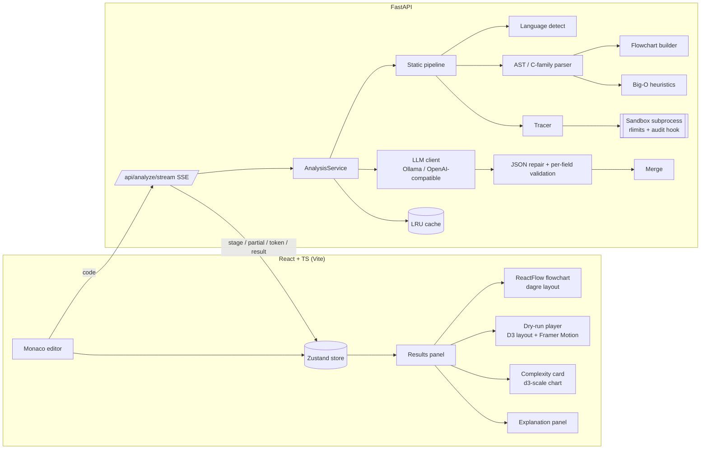

# CodeLens: AI code visualizer and DSA analyzer

Paste **any** code. CodeLens gives you:

- **Flowcharts.** One control-flow diagram per function. You can zoom, pan, and export them as PNG, SVG, or Mermaid.
- **Animated dry runs.** Arrays, matrices, stacks, queues, hash maps, linked lists, trees, heaps, and graphs, with pointer and swap highlights.
- **A step player.** Play, pause, step forward and back, scrub, change speed (0.5×–4×), set breakpoints, and watch variables and stdout. The editor highlights the current line.
- **Complexity analysis.** Best, average, and worst-case Big-O, the reasoning behind it, an n-vs-operations chart, and space complexity.
- **Plain-English explanations.** A typewriter-style summary, an "Explain like I'm 5" toggle, key concepts, edge cases, optimisations, and related patterns.
- **Convenience features.** Language auto-detection, example presets, drag-and-drop upload, share-by-URL, and a history sidebar. The dark/light glassmorphism UI works on desktop and tablet.

## LeetCode mode

Switch the editor to **LeetCode**, then search by number, title words, slug or URL (e.g. `887`, `two sum`). Suggestions come from the 23 bundled problems and from leetcode.com. Choose **Python 3** or **C++**.

- **Problem loading.** The statement, signature and Python starter code load, and the examples become test cases. Bundled problems work offline. Any other public problem is fetched from leetcode.com once, then cached in `backend/.cache/leetcode/`. Premium problems can't be fetched.
- **Custom tests.** Add your own test cases in LeetCode's input format, one value per line: `[2,7,11,15]` then `9`. Trees use level order (`[3,9,20,null,null,15,7]`), and design problems take the operations list and the arguments list. The expected output is optional. Custom tests and your code are saved per problem.
- **Run tests.** Your `Solution` is judged on every case in the sandbox. Each case gets a verdict like LeetCode's: Accepted, Wrong Answer, Runtime Error, Time Limit Exceeded or Compile Error. You also see your output, the expected output, stdout and run time. You can compare outputs exactly, in any order, or in any order at every level of nesting.
- **Native C++ dry runs.** Your code is instrumented (a recorder call before each statement, same line numbers), compiled and run in the sandbox, so the trace shows real values: arrays with index pointers, hash maps, stacks/queues, linked lists whose arrows flip as you rewire them, and whole trees with the current node highlighted inside recursive helpers. Segfaults show the steps leading up to the crash. The AI trace is only a fallback (e.g. JavaScript, or code the instrumenter can't handle).
- **Ask CodeLens (chat).** The button at the bottom left opens a tutor chat. It automatically sends your code, the problem, the complexity, the current dry-run step and any failing tests to the model, so you can ask "why did `cnt` change here?" or "give me a hint".
- **C++.** Your class is compiled with clang++/g++ (C++17, a `bits/stdc++.h` shim for macOS) and each test runs in its own process with time limits. On macOS it also runs under `sandbox-exec` without network access. Compile errors point at your lines, and segfaults show as a Runtime Error. 
- **Visualize.** Runs the dry run on that one test case, with `ListNode`/`TreeNode` inputs built for you. Trees and lists animate as whole structures, and class-based solutions (e.g. MinStack) show their `self.<field>` state.

| Method | Path | Purpose |
|---|---|---|
| GET | `/api/leetcode/problems` | bundled problem list |
| GET | `/api/leetcode/search?q=` | suggestions: bundled + live leetcode.com |
| GET | `/api/leetcode/problems/{ref}` | problem by number / slug / title / URL |
| POST | `/api/leetcode/run` | `{code, problem, tests: [{input, expected?}], compare?, language?: python|cpp}` → per-test verdicts |
| POST | `/api/analyze` | add `problem` + `test_input` to trace a solution on a test case |

## Architecture



### Analysis pipeline

```mermaid
sequenceDiagram
  participant UI
  participant API as FastAPI
  participant Static as Static pipeline
  participant Box as Sandbox
  participant LLM
  UI->>API: POST /api/analyze/stream {code}
  API->>Static: detect → parse → flowchart → Big-O
  Static->>Box: run code under sys.settrace (Python)
  Box-->>Static: line events + variable snapshots
  API-->>UI: event: partial (usable result in ~100 ms)
  API->>LLM: prompt with code + static facts (JSON mode, streamed)
  LLM-->>API: tokens…
  API-->>UI: event: token {chars}
  API->>API: repair JSON, validate each field, merge
  API-->>UI: event: result (AI-enhanced)
```

**Key design decision: ground truth first, LLM second.** A 7–10B model can't be trusted to invent an accurate execution trace. So for Python, the dry run comes from *actually running* the code in a sandbox. Flowcharts and complexity come from AST analysis, which is deterministic and instant. The LLM adds the summary, concepts, edge cases, and optimisations, and its complexity answer overrides the heuristic. For the other languages, it also produces the dry run, which is clearly labelled as AI-generated. As a result:

- the app is fully usable **without any model** ("Static mode"), and
- the LLM is told the static facts in its prompt, so it explains rather than guesses.

## Quick start (one command)

```bash
./start.sh            # installs deps, starts Ollama, pulls the right model, runs API + web app, opens the browser
./start.sh setup      # install + pull the model only
./start.sh test       # backend tests + lint, frontend tests, type-check + build
```

The script picks the model from your RAM: **≥ 24 GB → `qwen2.5-coder:14b`**, **16–23 GB → `qwen2.5-coder:7b`**, **< 16 GB → `qwen2.5-coder:3b`**. Python and C++ dry runs don't use the model at all (they're real execution traces); the model writes explanations and answers chat questions, where a bigger model gives clearer, more accurate answers but responds more slowly. Override it with `OLLAMA_MODEL=… ./start.sh`. Logs go to `.logs/`, and Ctrl+C stops everything except Ollama.

## Manual setup

```bash
# 1. Backend (Python 3.11+)
cd backend
python -m venv .venv && source .venv/bin/activate
pip install -r requirements-dev.txt
cp .env.example .env            # optional: configure the LLM
uvicorn main:app --reload --port 8000
```

```bash
# 2. Frontend (Node 18+)
cd frontend
npm install
npm run dev                      # http://localhost:5173 (proxies /api → :8000)
```

```bash
# 3. Optional: local LLM for AI explanations
ollama pull qwen2.5-coder:7b
```

With `LLM_PROVIDER=auto` (the default), the backend uses Ollama when it is reachable. Otherwise it falls back to an OpenAI-compatible endpoint if `OPENAI_API_KEY` is set, and to static mode if neither is available. The navbar pill shows which mode is active.

## API

| Method | Path | Body | Returns |
|---|---|---|---|
| GET | `/api/health` | – | status, LLM provider/model/availability |
| POST | `/api/analyze` | `{code, language?, entry_call?, use_llm?}` | `AnalysisResult` |
| POST | `/api/analyze/stream` | same | SSE: `stage`, `partial`, `token`, `result`, `error`, `done` |
| POST | `/api/visualize` | `{code, language?}` | `Flowchart` |
| POST | `/api/dryrun` | `{code, language?, entry_call?}` | `DryRun` |
| POST | `/api/complexity` | `{code, language?}` | `Complexity` |
| POST | `/api/explain` | `{code, language?, eli5?}` | `Explanation` |

Schemas live in `backend/api/schemas/response.py` and are mirrored in `frontend/src/types/index.ts`. If Python code only *defines* functions, the backend synthesises a sample call from the parameter names (`arr` → a list, `target` → 7, `graph` → an adjacency dict). You can also pass `entry_call` (in the UI, the "Dry-run call" field).

## Project layout

```
backend/
  main.py                    app factory, CORS, rate limit, lifespan
  api/routes/                analyze (JSON + SSE), visualize, dryrun, complexity, explain, health
  api/schemas/               Pydantic request/response models
  core/analysis_service.py   orchestration, cache, streaming events
  core/static_pipeline.py    LLM-free analysis
  core/code_parser.py        language detection, C-family comment stripping
  core/diagram_generator.py  Python AST → flowchart
  core/c_parser.py           structural parser for JS/TS/C++/Java/Go/Rust
  core/c_flowchart.py        C-family IR → flowchart
  core/complexity_*.py       Big-O cost algebra + per-language fact extraction
  core/tracer.py             trace → steps; ds_inference / ds_highlights pick + annotate the data structure
  core/llm_engine.py         Ollama, OpenAI-compatible, fallback, null clients
  core/json_utils.py         robust JSON extraction (fences, trailing commas, truncation)
  core/llm_merge.py          per-field validation + merge of LLM output
  models/prompts.py          prompt templates (few-shot, JSON-only)
  models/knowledge.py        offline explanations for well-known algorithms
  sandbox/                   executor (subprocess + rlimits), guard (audit hook), harness (settrace)
frontend/src/
  components/editor/         Monaco (bundled locally), toolbar, presets, upload, share
  components/visualization/  flowchart, dry-run tab/player, ds/* renderers, complexity, explanation
  components/ui/             GlassCard, GlowButton, LoadingOrb, TabsPanel, Toast
  hooks/ stores/ services/ utils/ types/ styles/
```

## Testing

```bash
cd backend && pytest            # 116 tests: tracer, sandbox, flowcharts, Big-O, LLM, API, SSE, LeetCode judge/fetch
cd backend && ruff check .
cd frontend && npm test         # vitest: language detection, Big-O helpers, share links, SSE parsing, diagram utils
cd frontend && npm run build    # strict TypeScript + production bundle
node frontend/e2e/smoke.cjs     # Playwright: every preset × every tab, breakpoints, LeetCode run + visualise
```

## Security

Untrusted code runs in a separate `python -I` process with these protections:

- **Resource limits:** CPU seconds, a 256 MB address space, zero-byte file writes, and no child processes.
- **Wall-clock timeout:** the parent kills the whole process group when time runs out.
- **Audit hook:** a PEP 578 hook that cannot be removed denies sockets, subprocesses, file writes, `ctypes`, threads, and similar capabilities.
- **Step and output caps:** the tracer stops after a fixed number of steps and limits output size.

The API also enforces input size limits, per-IP rate limiting, and CORS. For a public deployment, also run the API container without outbound network access (see `backend/Dockerfile`). Audit hooks are defence in depth, not a security boundary.

## Known limitations

- Live tracing is Python-only. Dry runs for other languages come from the LLM and are labelled as AI-generated.
- On macOS the sandbox's memory cap (`RLIMIT_AS`) isn't enforced by the OS. The CPU-time limit, timeout and audit hook still apply.
- Static Big-O is a heuristic covering loops, halving, recursion patterns, memoisation, graph traversal, and tree recursion. When an LLM is available, its answer is preferred, and disagreements are surfaced as warnings.
- The C-family parser is structural, not a full grammar. Unusual syntax degrades to plain "process" nodes.
- The reference photos and website mentioned in the brief were not provided. The design follows the brief's own token spec (glass, blur, indigo/emerald accents, gradient orbs).
